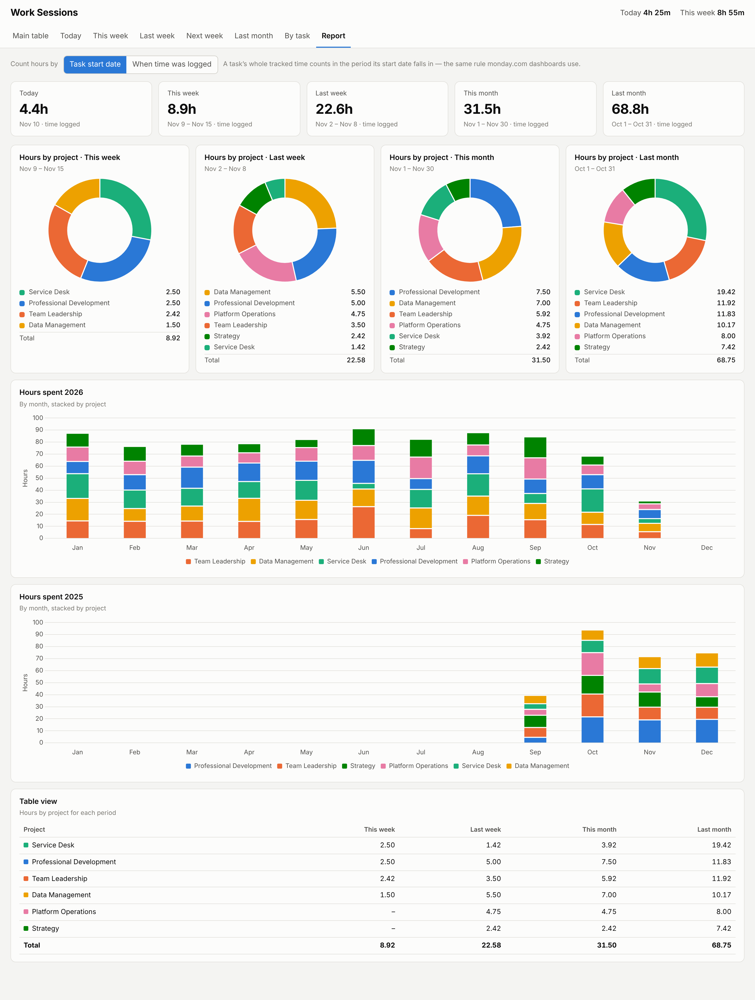
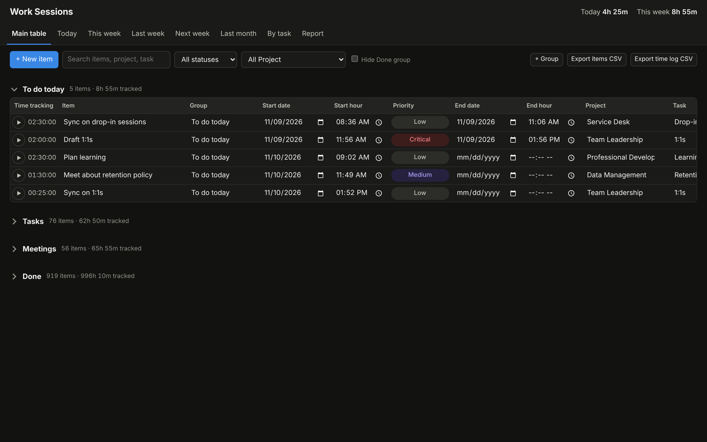

# Work Sessions

A small, free, self-hosted time-tracking board with a report dashboard — a local
alternative to a monday.com time-tracking board. It runs on your own machine with
nothing but Python's standard library. Your data stays in one SQLite file.



## Features

- **Board** grouped like monday — edit every field in place: name, group, start/end
  date and hour, priority, project, task, status.
- **▶ / ■ timer** on every row; several can run at once. Live totals for today and this week.
- **Views:** Main table · Today · This week · Last week · Next week · Last month · By task,
  with search and status / project filters.
- **Item details:** full time log (edit or add sessions by hand), subitems, notes,
  duplicate, delete, plus any extra columns brought in from an import.
- **Report:** today / week / month totals, hours-by-project donuts for this week,
  last week, this month and last month, month-by-month stacked bars for this year and
  last year, and a table view.
  Switch between counting a task's whole time in the period its *start date* falls in
  (monday.com's dashboard rule) or counting each session on the day it was *logged*.
- **Import** any monday.com board exported to Excel, including the time-tracking log,
  updates and subitems — columns are detected automatically.
- **CSV export** of items and of the full time log. Daily database backups.
- Light and dark mode. Works offline. Listens on `127.0.0.1` only.



## Quick start

Requires Python 3.8+ (on macOS, `python3` comes with the Command Line Tools).

```bash
git clone <this repo> work-sessions
cd work-sessions
python3 app.py --demo        # try it with generated sample data
python3 app.py               # start your own (empty) board
```

On macOS you can also double-click **`Start Work Sessions.command`**
(the first time, right-click → Open to get past Gatekeeper).

## Moving from monday.com

1. In monday, open the board → **⋯** → **More actions** → **Export board to Excel**.
2. Import it (openpyxl is only needed for this step):

```bash
pip3 install openpyxl
python3 import_monday.py ~/Downloads/My_Board_1234567890.xlsx --dry-run   # check the column mapping
python3 import_monday.py ~/Downloads/My_Board_1234567890.xlsx
python3 app.py
```

The importer:

- keeps every item in its monday group, with each item's tracked total exactly as monday had it;
- reads the **Time tracking** sheet so every timer session keeps its real date and time;
- turns **updates** into notes and keeps **subitems**;
- writes `data/config.json` with your board's title, groups, statuses, priorities and
  column names, so the app looks like your board.

Columns are matched by header name (`Start Date`, `Start Hour`, `End Date`, `End Hour`,
`Priority`, `Status`, `Time tracking`, `Item ID`, and the first headers containing
"project" and "task"). Override any of them:

```bash
python3 import_monday.py export.xlsx --map project="Client" --map task="Workstream"
```

Other columns are kept per item and shown read-only in the item's details.

## Configuration

Settings live in `data/config.json` (see [`config.example.json`](config.example.json)
for every option). Anything you leave out uses the default.

| Key | What it does |
| --- | --- |
| `title` | Name shown in the header and browser tab |
| `port` | Local port (default 8765) |
| `week_starts` | `"monday"` or `"sunday"` |
| `labels.project`, `labels.task` | Column names for the two category fields |
| `groups`, `default_group` | Board groups, and where new items go |
| `statuses` | `[{"name", "tone"}]` — tone is `neutral`, `warning`, `success` or `critical` |
| `default_status`, `start_status`, `done_status` | New items; set when a timer starts; marks done (stops timers, stamps end date) |
| `priorities`, `default_priority` | `[{"name", "tone"}]` — tone is `critical`, `high`, `moderate` or `low` |
| `report_basis` | Default report rule: `"start"` or `"logged"` |
| `history_year_from_month` | First month on the previous-year chart (1–12) |

## Your data

Everything is in the `data/` folder (git-ignored):

- `worksessions.db` — the SQLite database (open it with any SQLite tool)
- `config.json` — your settings
- `backups/` — one copy of the database per day the app is started

Use `--data /some/folder` or `WORKSESSIONS_DATA=/some/folder` to keep data elsewhere,
for example in a cloud-synced folder. Only run one copy of the app against a database at a time.

## Development

```bash
python3 -m unittest discover -s tests
```

`app.py` is the whole server (standard-library `http.server` + `sqlite3`);
`static/index.html` is the whole front end (vanilla JS + Chart.js, vendored under its MIT licence).

## Acknowledgement

This project was vibe coded with [Claude](https://claude.ai) (Anthropic): the app,
the monday.com importer, the tests and this README were written by Claude through
conversation, then reviewed and tested on real data.

## Licence

MIT. Not affiliated with or endorsed by monday.com.
